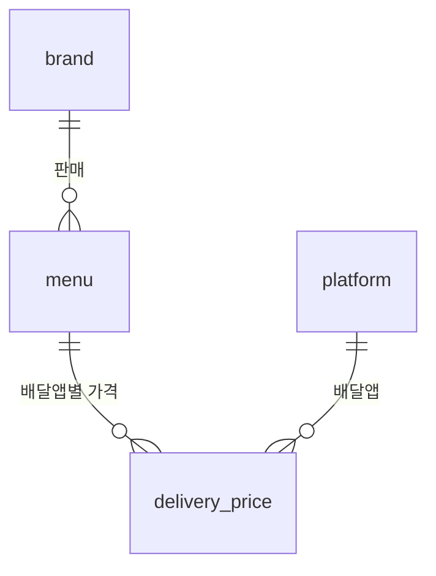

# 배달하면 얼마 더? — 매장가 vs 배달앱 가격 비교

26-2 웹서버개발 팀 C. 같은 메뉴를 매장에서 살 때와 배달앱으로 시킬 때 가격이 얼마나 다른지 보여 주는 사이트입니다.
지금은 **교촌치킨 치킨 메뉴 77종**으로 만든 프로토타입이고, 테이블은 **4개**만 씁니다.

- PHP 코드와 발표용 예제 분석 : [`php/README.md`](php/README.md)
- DB 만들기 : [`php/SQL.txt`](php/SQL.txt)

---

## 1. 왜 교촌치킨인가

"공식 홈페이지에 치킨 가격이 전부 나와 있는 브랜드" 기준으로 확인했습니다 (2026-10-05).

| 브랜드 | 공식 홈페이지 가격 | 판단 |
|---|---|---|
| **교촌치킨** | 치킨 메뉴 **77종 전부** '권장소비자가격' 표시, 시리즈별 분류 탭, 조리 전 중량까지 표시 | **선택** |
| BBQ | 주문 사이트에 가격은 있지만 굿즈 증정 세트·한정 메뉴가 섞여 있어 정리가 더 필요 | 다음 후보 |
| bhc | 메뉴 목록에 이름·설명만 있고 가격이 없음 | 제외 |

교촌치킨은 주제와도 잘 맞습니다. 2025년 9월 보도에 따르면 서울 지역 교촌치킨 가맹점의 90% 이상이 허니콤보·레드콤보 등을
**배달앱에서만 2,000원 올려** 팔고(허니콤보 23,000 → 25,000원), 매장과 교촌 자사앱 가격은 그대로 두었습니다. 본사는 일괄 인상을 지시하지 않았다는 입장입니다.

- 출처 : [교촌치킨 치킨 메뉴](https://www.kyochon.com/menu/chicken.asp) ·
  [뉴시스 2025-09-29](https://www.newsis.com/view/NISX20250929_0003347741) ·
  [한국일보 2025-09-29](https://www.hankookilbo.com/News/Read/A2025092914290003647)
- 공식 홈페이지에도 "매장마다 판매 가격이 상이할 수 있습니다"라고 적혀 있어서, 이 사이트의 **매장가 = 공식 권장소비자가격**입니다.

---

## 2. 테이블 4개



| 테이블 | 하는 일 | 주요 컬럼 |
|---|---|---|
| `brand` | 브랜드 | `name`, **`food_type`**(치킨·피자·버거…), `homepage`(매장가 출처), `checked_on`(확인일) |
| `menu` | 메뉴와 매장가 | `brand_id`, `category`(허니시리즈…), `name`, **`store_price`**(매장가), `size_info`(10호 닭, 조리 전 700g…), `image` |
| `platform` | 배달앱 | `name`(배달의민족·쿠팡이츠·요기요·자사앱), **`default_markup`**(조사 전 기본값 규칙), `sort_order` |
| `delivery_price` | 메뉴 x 배달앱 가격 | PK(`menu_id`, `platform_id`), **`price`**(앱 메뉴 가격), `delivery_fee`(배달팁), **`is_default`**, `store_name`(조사 매장), `checked_on`(조사일) |

확장을 위해 이렇게 잡았습니다.

- **다른 음식** : 음식 종류가 `brand.food_type` 컬럼이라서 피자·버거 브랜드도 **행만 추가**하면 됩니다 (테이블 추가 없음).
- **다른 브랜드** : `insert.php`에서 처음 보는 브랜드 이름을 쓰면 브랜드와 메뉴가 함께 추가되고 기본 배달가도 자동으로 생깁니다.
- **다른 배달앱** : `platform`에 한 줄 추가 → `SQL.txt` 4) 를 다시 실행하면 빠진 칸만 기본값으로 채워집니다. 비교표의 열도 자동으로 늘어납니다.
- 정규형은 일부러 지키지 않은 곳이 있습니다 : 양·구성은 텍스트 한 칸(`size_info`), 조사 매장 이름은 매장 테이블 없이 `delivery_price.store_name`에 바로 저장.

---

## 3. 배달가 기본값

배달앱 API 를 쓸 수 없어서 **배달가는 아직 전부 기본값**입니다 (77 메뉴 x 4 앱 = 308칸).

| 배달앱 | 기본값 규칙 (`default_markup`) | 근거 |
|---|---|---|
| 배달의민족, 쿠팡이츠, 요기요 | 매장가 **+2,000원** | 2025년 9월 서울 교촌 가맹점 배달앱 가격 인상 보도 |
| 자사앱 | 매장가 그대로 (+0원) | 같은 보도 : 매장·자사앱 가격은 유지 |

- `is_default = 1`(기본값)인 칸은 화면에 **회색 기울임**, 직접 조사해 저장한 칸(`is_default = 0`)은 **검정**으로 표시합니다.
- 배달팁(`delivery_fee`)은 기본값이 없습니다 (NULL = 모름). 조사할 때 함께 적으면 됩니다.
- 실제 메뉴별로는 2,000원이 아닐 수 있고(보도는 콤보 메뉴 위주), 지역·매장마다 다릅니다. **조사 전 임시값**일 뿐입니다.

---

## 4. 직접 조사하는 방법 (다음 할 일)

1. 배달앱에서 교촌치킨 매장 **한 곳**을 정합니다 (예 : 배민 → 교촌치킨 OO점). 앱끼리 비교하려면 모든 앱에서 **같은 매장**을 보는 게 공정합니다.
2. 사이트의 **배달가 입력**(`price.php`) → 브랜드 `교촌치킨`, 배달앱 `배달의민족` → 불러오기
3. 위쪽 **조사 정보**에 조사 매장, 조사일, 배달팁을 적습니다 (다음에 들어와도 기억됨).
4. 앱에 보이는 가격을 **새 배달가**에 적습니다. 고친 줄은 자동으로 체크되고, **체크한 줄만** 저장됩니다.
   쿠폰·할인 전 **정가**를 적고, 앱에 없는 메뉴는 그대로 두면 기본값으로 남습니다.
5. 쿠팡이츠, 요기요, 자사앱(교촌치킨 앱)도 같은 방법으로 반복 → **차액 랭킹**에서 '직접 조사한 가격만'을 체크하면 실제 순위가 나옵니다.

phpMyAdmin 에서 바로 고쳐도 됩니다 (`is_default`를 0으로, `checked_on`도 함께). 예시는 `SQL.txt` 6) 에 있습니다.

---

## 5. 화면

| 화면 | 파일 | 내용 |
|---|---|---|
| 가격 비교 | `search.php` | 메뉴 x (매장가 + 배달앱 4곳) 비교표, 검색·음식·브랜드·분류 필터, 평균 차액 요약 |
| 차액 랭킹 | `ranking.php` | 배달앱별 평균 차액(GROUP BY), 배달앱 탭별 메뉴 순위(비율순·금액순, 동점 같은 순위) |
| 배달가 입력 | `price.php` | 브랜드 x 배달앱 하나를 골라 여러 메뉴 가격을 한 번에 저장, 기본값으로 되돌리기 |
| 메뉴 추가 | `insert.php` | 새 메뉴(새 브랜드·새 음식 포함) 추가, 기본 배달가 자동 생성 |
| 메뉴 삭제 | `delete.php` | 목록에서 골라 삭제 (배달가도 함께 삭제) |

---

## 6. 폴더 구조

```
price-gap/
├─ README.md            이 문서 (주제, 테이블, 데이터, 조사 방법)
└─ php/
   ├─ README.md         예제 분석·수정 내용, 서버 실행 방법, 시연 순서 (발표용)
   ├─ SQL.txt           DB 만들기 : 테이블 4개 + 교촌치킨 77메뉴 + 기본 배달가
   ├─ SQLconstants.php  DB 접속 정보 (서버에서 비밀번호만 수정)
   ├─ util.php          공통 함수 (DB 연결, Prepared Statement, 출력 이스케이프 ...)
   ├─ log.php           접속 로그 (log.txt)
   ├─ header.php, footer.php, style.css
   ├─ search.php + selectSQL.php    가격 비교
   ├─ insert.php + insertSQL.php    메뉴 추가
   ├─ delete.php + deleteSQL.php    메뉴 삭제
   ├─ price.php  + priceSQL.php     배달가 입력
   ├─ ranking.php                   차액 랭킹
   └─ index.php                     search.php 로 이동
```
